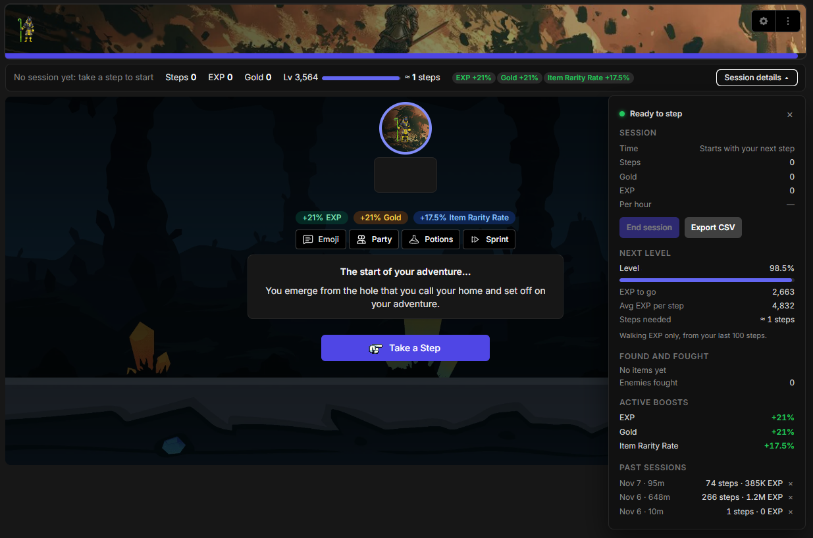
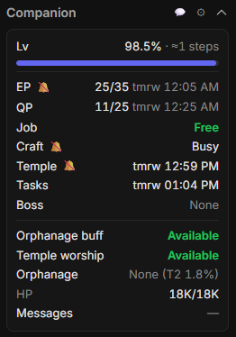

# SMMO Travel Companion

A userscript for [SimpleMMO](https://web.simple-mmo.com) that keeps your cooldowns, walking stats and everyday pages in one place.

**It never clicks or plays for you.** You take every step, fight and quest yourself. The Companion only shows information and opens the game's own windows.

## What it does

**Always in view**
- A Companion block in the left menu with EP and QP (with your own alert target), job shift, crafting, temple, daily tasks, world boss, orphanage tier and HP. Click any time to switch between clock times and countdowns.
- Alerts (sound, tab title, desktop notification) when a cooldown ends. Every row can be switched on or off.
- Works with both the classic and the new website layout.

**Travel**
- Session tracker with steps, EXP, gold, loot by rarity and enemies fought. A session starts with your first step and ends when you end it or stop for a while.
- Steps to your next level, based on your real average EXP per step.
- Past sessions, with CSV export.

**Pages as popups**
- Inventory, Battle, Quests, Crafting, Profession, Tasks, notifications, chat and the human check open in a popup, so Travel stays your main page.

**Planning**
- Shift planner on the Profession page: pick what you want to wait for, and see how long to work so you finish just before, on time or just after. It knows your energy and fills in the minutes (you press Start).
- Quests: the quest closest to finishing is shown first, with a sort button for the list.
- Orphanage tier and an alert when Tier 3 is active.

**Items**
- NEW badges for items not yet in your collection, and an Add to Collection button in the item window.
- Shop items and uncollected items are greyed out in Town Supply Requests and the Item Dumping Grounds.

## Optional: Public API key
Add your key in the settings (⚙) for player stats, skills and the Diamond Market watcher. Everything else works without it. The key stays in your browser.

## Bugs and feature requests
Found a bug or want a feature? Please open an issue:
**https://github.com/Reacien/Userscripts/issues**

Say which page you were on, what you expected and what happened. A screenshot helps. Never include your API key.

## License
All rights reserved. You may install and use the script, but not copy, modify or redistribute it.