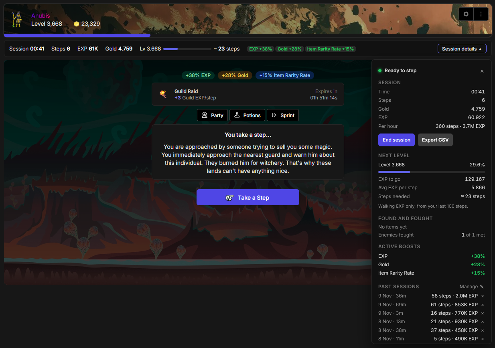
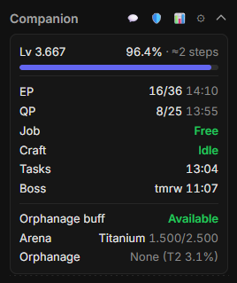
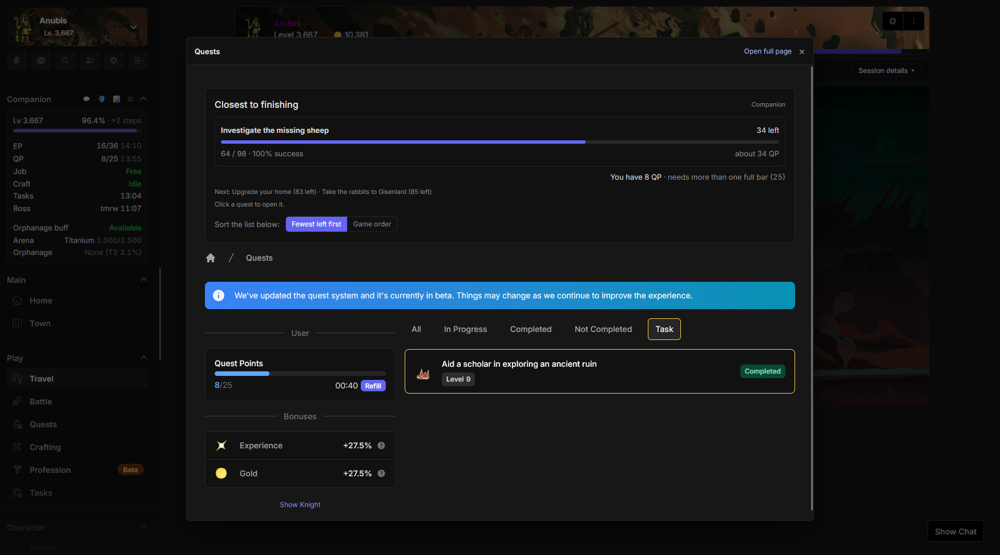
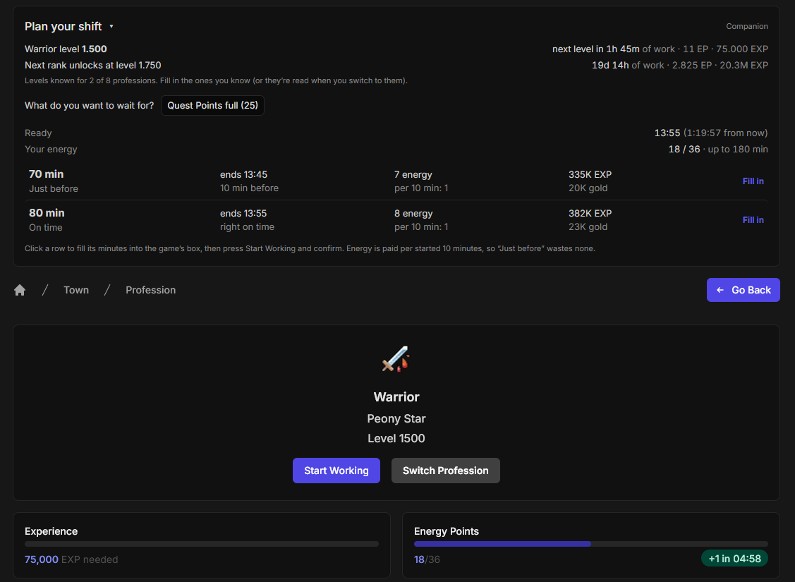
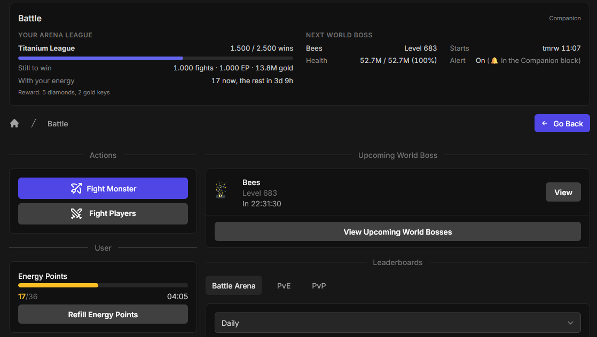
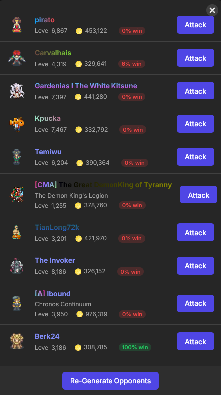
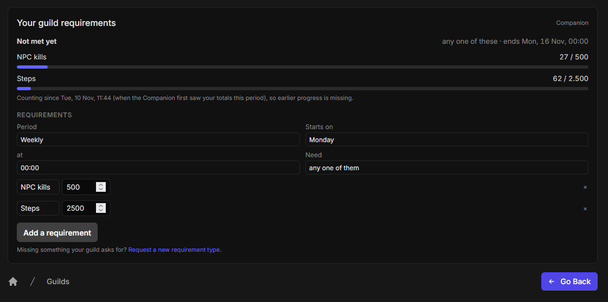
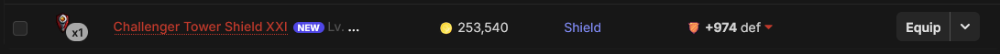
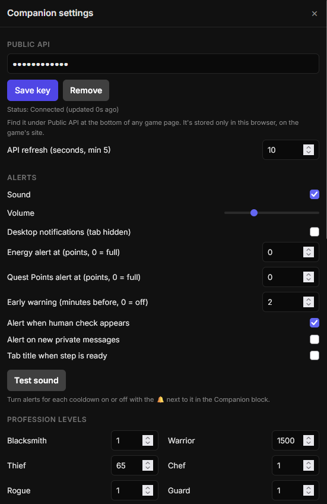

# SMMO Travel Companion

A userscript for [SimpleMMO](https://web.simple-mmo.com) that keeps cooldowns, travel statistics, everyday pages and progression information in one place.

## Installation

1. Install a userscript manager such as Tampermonkey or Violentmonkey.
2. Install [**SMMO Companion**](https://greasyfork.org/en/scripts/604450-smmo-companion) from Greasy Fork.
3. Open [SimpleMMO](https://web.simple-mmo.com).
4. Open the Companion’s ⚙️ menu to choose your settings.

The script runs on `https://web.simple-mmo.com`.

## What it does not do

The Companion does not:

- Step, fight, craft, work or play for you
- Accept bounties
- Spend Quest Points
- Complete human checks
- Start profession shifts
- Buy Diamond Market listings

It can fill in a suggested profession shift duration, but you choose the shift and start it yourself.

## Highlights

- Track walking sessions: steps, EXP, gold, loot by rarity, enemies met and enemies fought.
- Pause, resume, end, manually add, copy between browsers and export walking sessions as CSV.
- See steps remaining to your next level using your recent walking EXP-per-step rate.
- Monitor EP, QP, profession shifts, crafting, temple worship, daily/weekly/monthly tasks, world boss, orphanage, HP, safe mode and sprint.
- Receive sound, tab-title, toast or desktop-notification alerts when a cooldown ends; desktop notifications are only sent while the SimpleMMO tab is hidden.
- Get an optional warning before a cooldown ends.
- Open game pages in popups, including Inventory, Battle, Quests, Crafting, Profession, Tasks, notifications, chat and the human check.
- Plan profession shifts around cooldowns, quests or a time you choose; the planner can fill in the shift duration, but you still start the shift yourself.
- Track Arena league profess, configurable gild requirements, opponent win chances and profession-rank work.
- Monitor obtainable bounties, show target HP and estimated win chances, and optionally open a target's attack page after you accept a bounty.
- Back up and restore settings, sessions and collection data; the API key is excluded from backups.
- Optionally connect a SimpleMMO Public API key for player statistics, skills, orphanage data, world-boss details and Diamond Market watching.

## Travel

### Session tracking
- A session starts with your first successful step.
- It records steps, EXP, gold, loot by rarity, enemies met and enemies fought.
- You can pause or end a session. A session also ends automatically after your chosen number of inactive minutes.
- You can manually add a session, paste a copied session from another browser, edit its duration, remove it, or export all sessions as CSV.
- Past sessions are shown on the Travel page and in the Sessions manager.

### Level progress
- Shows your current level, progress bar, EXP still needed and estimated steps remaining.
- Uses the average walking EXP from your last 100 steps.
- If fewer than three walking samples are available, it falls back to your lifetime steps and EXP.

### Travel boosts
- Remembers your current EXP, gold and item-rarity boosts from the Travel page.

## Daily companion

### Cooldowns and alerts
- Displays cooldowns as either countdowns or the local time they become ready.
- Lets you enable or disable alerts for individual cooldowns.
- Supports sound alerts, browser-tab title changes, on-page toasts and desktop notifications.
- Desktop notifications are sent only while the SimpleMMO tab is hidden.
- Includes an optional warning before a cooldown ends.
- Alerts for EP and QP can use a target amount instead of waiting until they are full.
- Alerts you when a new private message arrives, or Orphanage Tier 3 becomes active.

### Pages in popups
- Can open game pages in a popup, including Inventory, Battle, Quests, Crafting, Profession, Tasks, notifications, chat and the human check.
- Lets Travel remain your main page wile you handle other activities.
- Works from any SimpleMMO page, not only Travel.
- You can choose whether popups are available everywhere or only while you are on Travel.

## Progression

### Professions
- Shows your active profession’s level, remaining EXP and current work progress.
- Estimates work time, profession EXP and energy needed to reach a chosen profession level.
- Lets you enter levels for other professions so the planner can calculate their progress too.
- Suggests a shift duration that ends before, at, or shortly after a cooldown, quest or time you choose.
- Can fill in the suggested duration in the game’s Start Working window; you still choose and start the shift yourself.

### Battle and guild
- Tracks Arena league progress, remaining wins, completion and fight costs.
- Shows configurable guild requirements for steps and NPC kills over a daily, weekly or monthly period.
- Estimates battle win chances from available opponent information.
- Shows profession-rank work estimates.

### Items and collection
- Marks uncollected inventory items with a NEW badge.
- Adds an **Add to Collection** action in the item window.
- Lets you scan your Items, Collectables and Avatars collection pages; this runs manually or automatically once per day.
- Blocks shop items, your own blocked items and uncollected items in Town Supply Requests and the Item Dumping Grounds.

## Bounties

### Bounty monitoring
- Checks obtainable bounties and shows how many are available.
- Alerts you when an obtainable bounty target drops below 50% HP.
- Shows target HP and estimated win chances on player profiles and the Bounties page.
- Can open a target's attack page in a new tab after you accept a bounty.

## Optional API features

You can add a SimpleMMO Public API key in the settings (⚙️) to enable:

- Player statistics, skills, location, guild and membership information
- More reliable EP, QP and HP readings
- World-boss details when the Battle page has not provided them
- Orphanage tier information and the Tier 3 alert
- Diamond Market watching and price-threshold alerts

Everything else works without an API key. Your key remains in your browser and is excluded from Companion backup exports.

## Settings

Open the Companion’s ⚙️ menu to configure:

- Public API key and API refresh interval
- Alert sounds, volume, tab-title changes and desktop notifications
- Which Companion rows are visible
- Clock-time versus countdown display
- EP and QP alert targets
- Early-warning minutes before a cooldown ends
- Private-message and Orphanage Tier 3 alerts
- Profession levels for the planner
- Session idle timeout and automatic session resume
- Travel strip, page cards, collection badges and item-giving protection
- Chat popup, notification popup and keyboard shortcuts
- Bounty monitoring, low-HP alerts, win-chance chips and attack-page behaviour
- Blocked items
- Page-popup behaviour
- Background page checks and safety refresh interval
- Backup export and import
- Diamond Market watching, price threshold and refresh interval
- Crafting energy reserve

## Backup and restore

Use **Export backup** in Settings to save a JSON file containing:

- Companion settings
- Current and past walking sessions
- Lifetime walking totals
- Recent EXP-per-step samples
- Collection names
- Seen-cooldown state
- Chat dock state
- Blocked items

Use **Import backup** to replace the current settings, current session and past sessions in that browser.

Your SimpleMMO Public API key is **not** included in a backup. Keep the existing key when importing, or paste it again afterwards.

## Privacy and data

The Companion stores its settings, session data and cached game information in your browser’s `localStorage`. It does not send that data to a third-party service.

If you add an API key, it is stored locally in your browser and used only to call SimpleMMO’s official Public API. It is never included in Companion backup exports.

The Companion reads SimpleMMO pages to update cooldowns, statistics and other displayed information. Background checks can be turned off in Settings.

| View | What it shows |
|---|---|
|  | Travel session stats, estimated steps to your next level, active boosts and past sessions. |
|  | The sidebar Companion with level progress, EP and QP cooldowns, Arena progress and orphanage status, etc. |
|  | Quests open in a popup over Travel, with the closes-to-finishing quest highlight and sorting options. |
|  | The shift planner with suggested work durations, energy costs and rewards, timed around your chosen cooldown. |
|  | Arena league progress, remaining fights and costs, plus details of the next world boss. |
|  | Estimated win chances displayed beside each opponent before you choose who to attack. |
|  | Custom guild requirements with progress tracking for steps and NPC kills over a chosen period. |
|  | A NEW badge marking an item that is not yet in your collection. |
|  | Companion settings for the optional API key, alerts, refresh interval, profession levels and more. |

## Bugs and feature requests

Found a bug or want a feature? [Open an issue](https://github.com/Reacien/Userscripts/issues).

Please include:

- The page you were on
- What you expected
- What actually happened
- Your browser and userscript manager
- A screenshot, if relevant
- Console errors, if applicable

**Never share your API key.**

## License

All rights reserved. You may install and use the script, but you may not copy, modify or redistribute it.
