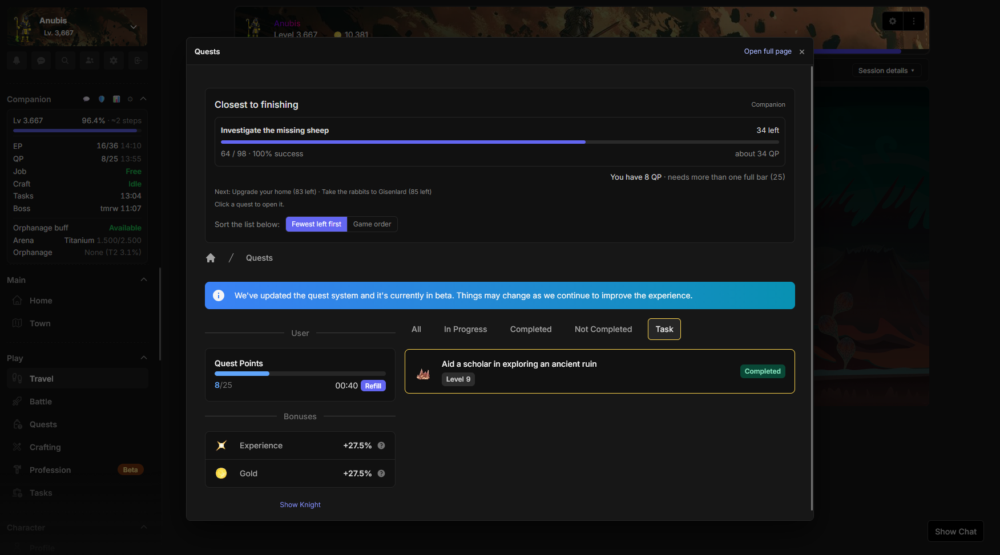
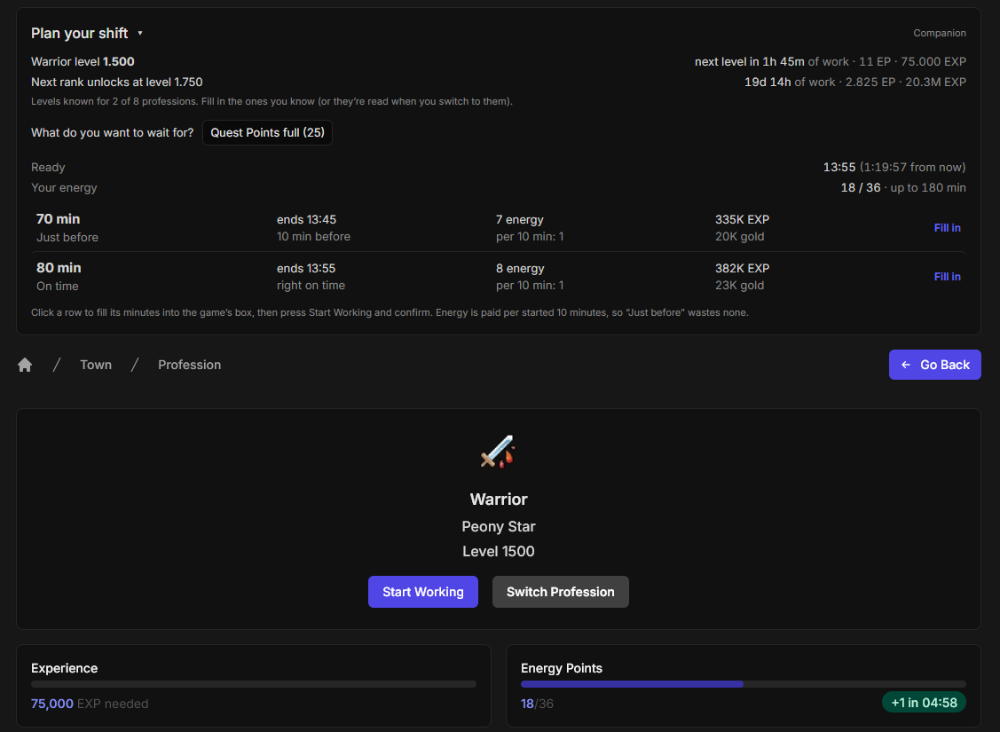
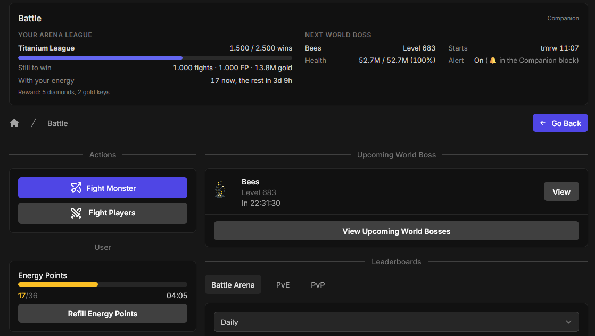
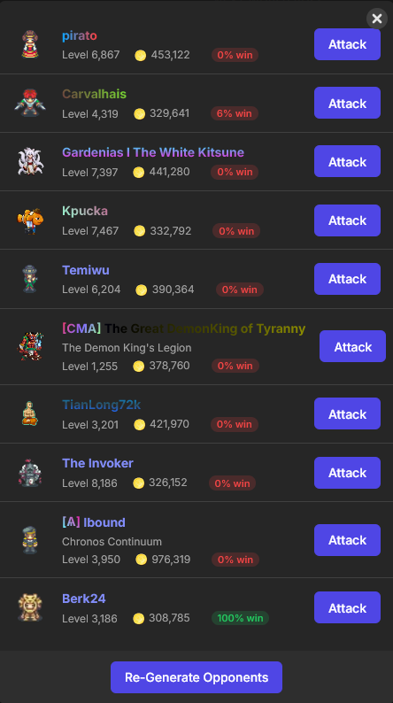
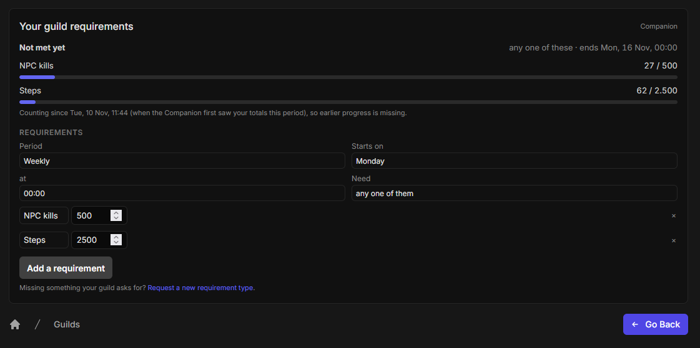
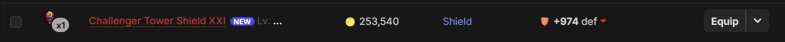
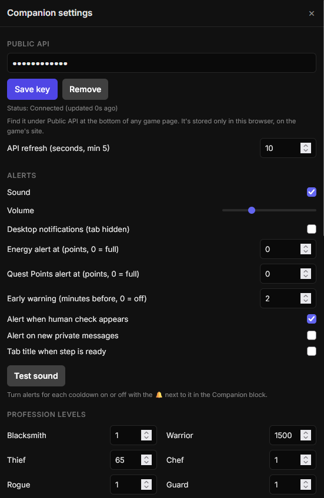

# SMMO Travel Companion

A userscript for [SimpleMMO](https://web.simple-mmo.com) that keeps cooldowns, travel statistics, everyday pages and progression information in one place.

**It never clicks, fights, steps, or plays for you.** You make every move; the Companion only surfaces information, provides shortcuts to the game's own pages, and opens game windows in popups.

## Highlights

- Track walking sessions: steps, EXP, gold, loot by rarity and enemies encountered.
- See steps remaining to your next level using your real recent EXP-per-step rate.
- Monitor EP, QP, profession, crafting, temple, daily tasks, world boss, orphanage and HP.
- Receive sound, tab-title or desktop-notification alerts when a cooldown ends.
- Open Inventory, Battle, Quests, Crafting, Profession, Tasks, notifications, chat and the human check as popups.
- Plan profession work around shifts, quests and other activities.
- Track Arena progress, guild requirements, battle estimates and profession-rank work.
- Highlight uncollected items and mark shop items you already own.
- Optionally connect a SimpleMMO Public API key for player statistics, skills and Diamond Market watching.

## Travel

### Session tracking
- A session starts with your first step and ends when you stop it, or after a period of inactivity.
- It records steps, EXP, gold, loot by rarity, and enemies met or fought.
- Past session can be reviewed and exported as CSV.

### Level progress
- Shows how many steps remain until your next level.
- Uses your recent average EXP per step, rather than a fixed estimate.

### Travel boosts
- Remembers your current EXP, gold and item-rarity boosts from the Travel page.

## Daily companion

### Cooldowns and alerts
- Displays cooldowns as either countdowns or the local time they become ready.
- Lets you enable or disable alerts for individual cooldowns.
- Supports sound alerts, browser-tab title changes and desktop notifications.
- Includes an optional warning before a cooldown ends.

### Pages in popups
- Opens Inventory, Battle, Quests, Crafting, Profession, Tasks, notifications, chat and the human check in a popup.
- Lets Travel remain your main page while you handle other activities.
- Works from any SimpleMMO page, not only Travel.

## Progression

### Professions
- Shows your active profession's level and remaining EXP.
- Estimates work time, EXP and energy needed to reach a chosen profession level.
- Lets you enter levels for other professions so the planner can calculate their progress too.

### Battle and guild
- Tracks Arena league progress and completion.
- Shows configurable guild requirements for steps and kills.
- Estimates battle win chances from available opponent information.
- Shows profession-rank work estimates.

### Items and collection
- Marks items that are not yet in your collection.
- Adds an **Add to Collection** action in the item window.
- Greys out shop items and uncollected items in Town Supply Requests and the Item Dumping Grounds.

## Optional API features

You can add a SimpleMMO Public API key in the settings (⚙️) to enable:

- Player statistics and skills
- Diamond Market watching
- More reliable refreshes for supported data

Everything else works without an API key. Your key remains in your browser and is excluded from [Hub](https://reacien.github.io/smmo-hub) exports.

## Settings

Open the Companion's ⚙️ menu to configure:

- Alert sounds, volume, tab-title changes and desktop notifications
- Which Companion rows are visible
- Clock-time versus countdown display
- Session idle timeout
- Background refresh frequency
- Page-popup behaviour
- Diamond Market watching and price threshold
- EP and QP alert targets
- Crafting energy reserve

## Privacy and ata

The Companion stores its settings, session data and cached game information in your browser's `localStorage`. It does not send your data to a third-party service.

If you add an API key, it is stored locally in your browser and used only to call SimpleMMO's official Public API. It is never included in [Hub](https://reacien.github.io/smmo-hub) exports

## Screenshots

| View | What it shows |
|---|---|
|  | Travel session stats, estimated steps to your next level, active boosts and past sessions. |
|  | The sidebar Companion with level progress, EP and QP cooldowns, Arena progress and orphanage status, etc. |
|  | Quests open in a popup over Travel, with the closes-to-finishing quest highlight and sorting options. |
|  | The shift planner with suggested work durations, energy costs and rewards, timed around your chosen cooldown. |
|  | Arena league progress, remaining fights and costs, plus details of the next world boss. |
|  | Estimated win chances displayed beside each opponent before you choose who to attack. |
|  | Custom guild requirements with progress tracking for steps and NPC kills over a chosen period. |
|  | A NEW badge marking an item that is not yet in your collection. |
|  | Companion settings for the optional API key, alerts, refresh interval, profession levels and more. |

## Bugs and feature requests

Found a bug or want a feature? [Open an issue](https://github.com/Reacien/Userscripts/issues).

Please include:

- The page you were on
- What you expected
- What actually happened
- Your browser and userscript manager
- A screenshot, if relevant
- Console errors, if applicable

**Never share you API key.**

## License

All rights reserved. You may install and use the script, but you may not copy, modify or redistribute it.
